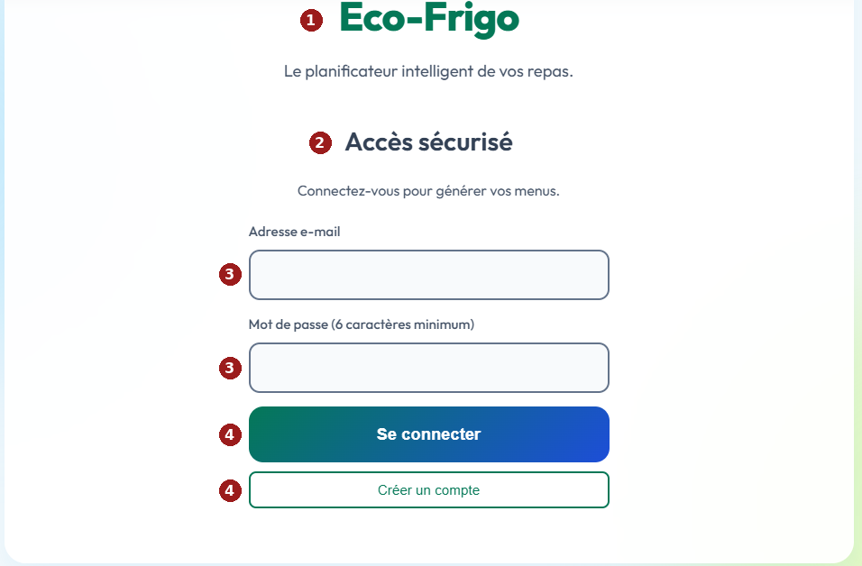
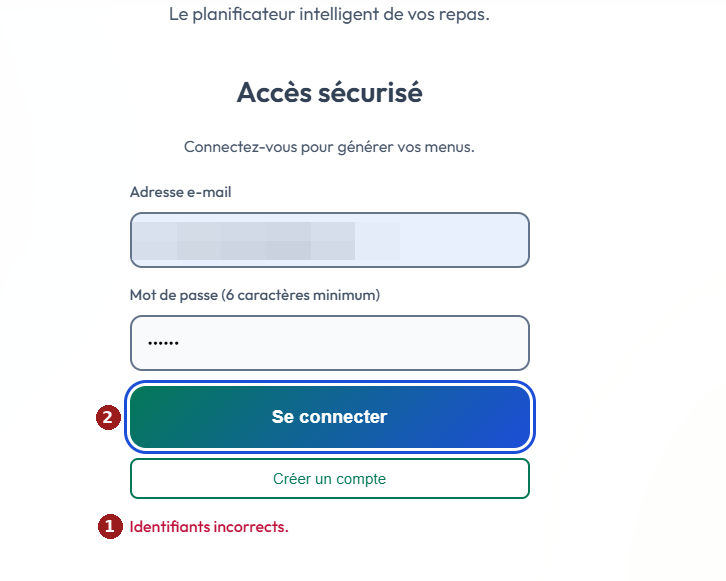
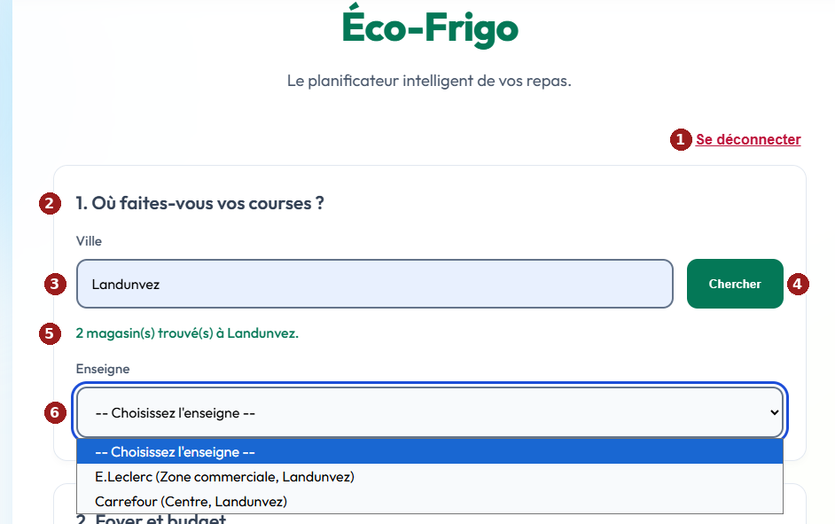
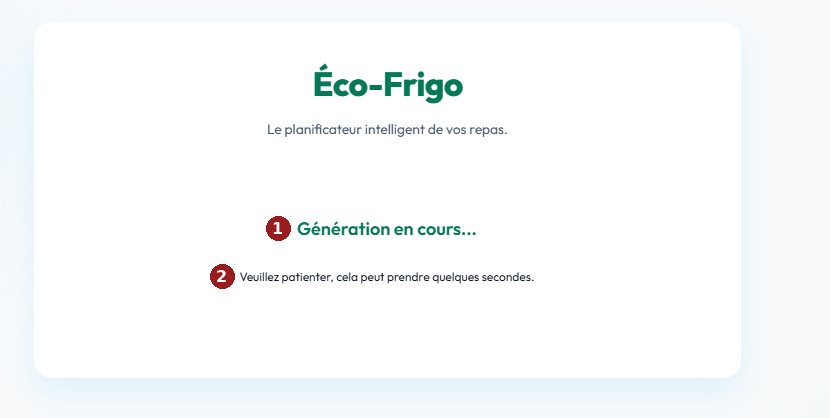
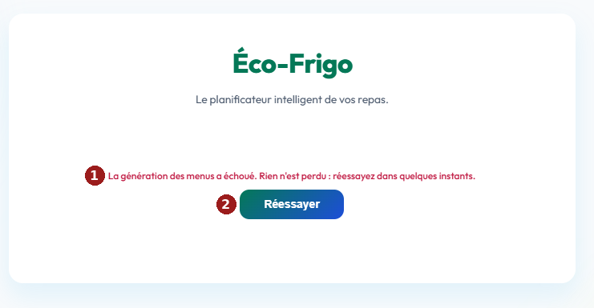
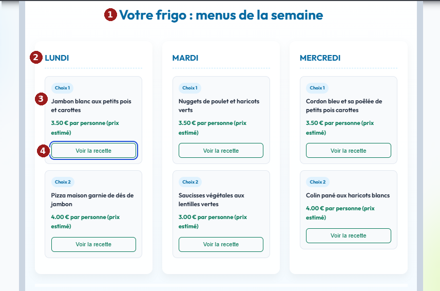
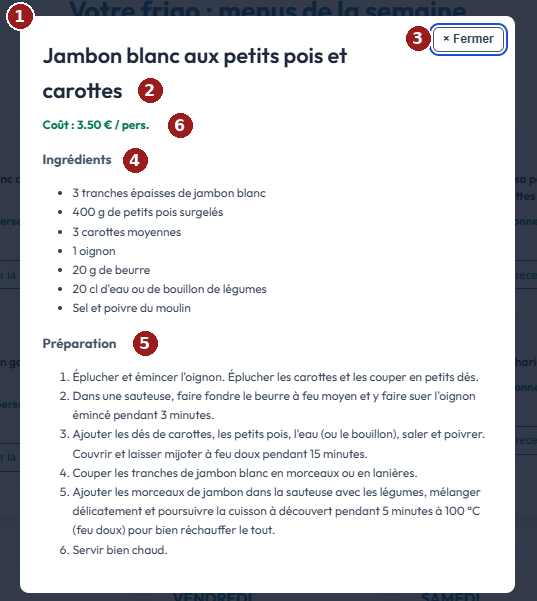
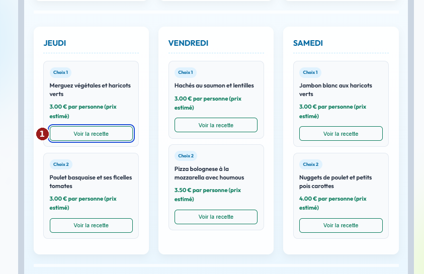

# Maquettes de l'interface d'Éco-Frigo : captures annotées (carte #11, C14)

Ce document complète les user stories et le parcours utilisateur (`modele-donnees-et-parcours.md`). Il présente les écrans de l'application sous forme de captures d'écran réelles, annotées, avec pour chacun les exigences d'accessibilité à respecter (WCAG 2.1 niveau AA, équivalent du RGAA) et ce qui est constaté sur l'interface.

## 1. Méthode

- Les captures ont été prises le 13 novembre 2026 sur l'interface réalisée (`templates/index.html`), après la mise en conformité d'accessibilité décrite dans le journal des problèmes. Elles montrent donc l'écran tel qu'il fonctionne, pas une intention de conception.
- Les repères rouges numérotés renvoient au tableau qui suit chaque capture.
- Chaque tableau indique l'exigence, puis le constat. Les constats sont de trois sortes : **visible** sur la capture (étiquette, contraste, cadre de focus), **code** (attribut relevé dans `index.html`, par exemple `role="alert"`), ou **calculé** (rapport de contraste mesuré à partir des codes couleur).
- L'annonce par un lecteur d'écran n'a **pas** été testée avec un vrai lecteur d'écran : elle est déduite du code. Ce test est prévu (voir la section 10).
- Sur la capture 2, l'adresse e-mail saisie est floutée.

**Contrastes calculés** (rapport minimal exigé : 4,5:1 pour le texte, 3:1 pour les contours et les cadres de focus) :

| Éléments | Couleurs | Rapport |
|---|---|---|
| Texte vert et boutons « Créer un compte », « Voir la recette » | vert foncé sur blanc | 5,5:1 |
| Texte blanc des boutons principaux | blanc sur le vert, puis sur le bleu du dégradé | 5,5:1 à 6,7:1 |
| Messages d'erreur | rouge foncé sur blanc | 6,3:1 |
| Titres des menus | bleu foncé sur blanc | 5,9:1 |
| Texte courant et étiquettes | gris foncé sur blanc | 7,6:1 |
| Contour des champs | gris moyen sur blanc | 4,8:1 |
| Cadre de focus clavier | bleu vif sur blanc | 6,7:1 |

## 2. Écran 1 : connexion (US1, US2)

**Description du schéma (texte alternatif) :** la page affiche le titre « Éco-Frigo », le sous-titre « Accès sécurisé », un champ « Adresse e-mail » et un champ « Mot de passe (6 caractères minimum) », chacun avec son étiquette écrite au-dessus, puis un bouton vert et bleu « Se connecter » et un bouton à contour vert « Créer un compte ».

| Rep. | Élément | Exigence | Constat |
|-----|---------------|------------------------------|--------------------|
| 1 | Titre « Éco-Frigo » | Titre de niveau 1 (1.3.1) | Code : `h1` |
| 2 | « Accès sécurisé » | Titre de niveau 2 (1.3.1) | Code : `h2` |
| 3 | Champs e-mail et mot de passe | Étiquette visible reliée au champ, aide écrite, `autocomplete` (1.3.1, 3.3.2, 1.3.5) ; contour visible (1.4.11) | Visible : étiquettes au-dessus des champs, aide « 6 caractères minimum » dans l'étiquette. Code : `label for`, `autocomplete`. Calculé : contour 4,8:1 |
| 4 | Boutons « Se connecter » et « Créer un compte » | Intitulés explicites, contraste du texte (1.4.3) | Visible : intitulés clairs. Calculé : 5,5:1 à 6,7:1 |

## 3. Écran 2 : erreur de connexion et focus (US2)

**Description du schéma (texte alternatif) :** le même écran de connexion, avec une adresse e-mail floutée et un mot de passe masqué. Le bouton « Se connecter » est entouré d'un cadre bleu (focus clavier). Sous le bouton « Créer un compte », le message « Identifiants incorrects. » est écrit en rouge foncé.

| Rep. | Élément | Exigence | Constat |
|-----|---------------|------------------------------|--------------------|
| 1 | Message « Identifiants incorrects. » | Message écrit, annoncé automatiquement, jamais la couleur seule (3.3.1, 4.1.3, 1.4.1) | Visible : texte écrit. Code : `role="alert"`. Calculé : rouge 6,3:1. Limite : le message ne dit pas lequel des deux champs est faux (choix de sécurité volontaire) |
| 2 | Bouton avec focus | Focus clavier visible (2.4.7) | Visible : cadre bleu épais autour du bouton. Calculé : 6,7:1 |

## 4. Écran 3 : configuration, magasin (US3)

**Description du schéma (texte alternatif) :** en haut à droite, un lien souligné « Se déconnecter ». Dans la section « 1. Où faites-vous vos courses ? », un champ « Ville » rempli avec « Landunvez » et un bouton vert « Chercher ». En dessous, le message vert « 2 magasin(s) trouvé(s) à Landunvez. », puis la liste « Enseigne » ouverte, qui propose E.Leclerc et Carrefour. Le début de la section « 2. Foyer et budget » apparaît en bas, coupé.

| Rep. | Élément | Exigence | Constat |
|-----|---------------|------------------------------|--------------------|
| 1 | « Se déconnecter » | Vrai bouton, texte visible, pas de couleur seule (1.4.1) | Visible : texte rouge foncé souligné (6,3:1) |
| 2 | « 1. Où faites-vous vos courses ? » | Titre de niveau 2 | Code : `h2` |
| 3 | Champ « Ville » | Étiquette visible reliée au champ (1.3.1, 3.3.2) | Visible : étiquette « Ville ». Code : `label for` |
| 4 | Bouton « Chercher » | Intitulé explicite, contraste | Visible. Calculé : 5,5:1 |
| 5 | Message de résultat | Résultat annoncé sans déplacer le focus (4.1.3) | Visible : texte. Code : `role="status"` |
| 6 | Liste « Enseigne » | Étiquette reliée, focus visible, choix lisibles (1.3.1, 2.4.7) | Visible : étiquette, cadre de focus bleu, choix avec adresse. Code : `label for` |

*Cette capture est coupée avant la section « Foyer et budget ». Une capture complète du bas de l'écran sera ajoutée.*

## 5. Écran 4 : chargement (US5)

**Description du schéma (texte alternatif) :** sous le titre de l'application, le titre vert « Génération en cours… » et la phrase « Veuillez patienter, cela peut prendre quelques secondes. ».

| Rep. | Élément | Exigence | Constat |
|-----|---------------|------------------------------|--------------------|
| 1 | « Génération en cours… » | Titre ; changement d'état annoncé sans déplacer le focus (4.1.3) | Code : `h2` dans une zone `role="status"` |
| 2 | Phrase d'attente | Texte lisible, sans animation obligatoire (2.2.2) | Visible : texte seul, aucune animation. Limite : l'attente peut durer plus de 10 secondes (appels à l'IA), sans indicateur de progression |

## 6. Écran 5 : échec de la génération (US5)

**Description du schéma (texte alternatif) :** le message rouge « La génération des menus a échoué. Rien n'est perdu : réessayez dans quelques instants. » et, en dessous, un bouton « Réessayer ».

| Rep. | Élément | Exigence | Constat |
|-----|---------------|------------------------------|--------------------|
| 1 | Message d'échec | Message clair, annoncé, avec la suite à donner (3.3.1, 4.1.3) | Visible : texte écrit. Code : `role="alert"`, focus placé dessus. Calculé : 6,3:1. Limite : le message ne distingue pas les causes (clé invalide, quota, surcharge du service d'IA), visibles seulement dans les logs |
| 2 | Bouton « Réessayer » | Action explicite pour sortir de l'erreur (3.3.3) | Visible. Code : relance la génération sans retaper les choix |

## 7. Écran 6 : les menus de la semaine (US5, US6, US7)

**Description du schéma (texte alternatif) :** le titre « Votre frigo : menus de la semaine » domine l'écran. Trois colonnes, Lundi, Mardi et Mercredi, contiennent chacune deux choix. Chaque choix affiche son numéro, le nom du plat (par exemple « Jambon blanc aux petits pois et carottes »), son prix par personne suivi de « (prix estimé) » et un bouton « Voir la recette ». Le premier bouton est entouré d'un cadre bleu.

| Rep. | Élément | Exigence | Constat |
|-----|---------------|------------------------------|--------------------|
| 1 | Titre de l'écran | Titre de niveau 1 (cet écran remplace la page d'accueil) | Code : `h1` |
| 2 | Nom du jour | Titre de niveau 2, ordre Lundi à Dimanche (1.3.1, 2.4.6) | Code : `h2`. Calculé : bleu 5,9:1 |
| 3 | Nom du plat et prix | Informations en texte ; prix signalé comme estimé tant que les vrais prix ne sont pas disponibles (US6) | Visible : « 3.50 € par personne (prix estimé) ». Code : texte inséré sans interprétation HTML |
| 4 | Bouton « Voir la recette » | Nom accessible unique, focus visible (2.4.6, 2.5.3, 2.4.7) | Visible : cadre de focus. Code : `aria-label` « Voir la recette : [nom du plat] » |

*Le bas de l'écran (bouton grisé « Valider et créer la liste de courses » et sa mention « Fonction bientôt disponible ») n'apparaît pas sur cette capture. Une capture sera ajoutée.*

## 8. Écran 7 : la fenêtre de recette (US7)

**Description du schéma (texte alternatif) :** une fenêtre blanche est posée sur l'écran des menus grisé. Elle contient le titre « Jambon blanc aux petits pois et carottes », un bouton « × Fermer » entouré d'un cadre bleu, la ligne « Coût : 3.50 € / pers. », la liste des 7 ingrédients avec leurs quantités et la liste numérotée des 6 étapes de préparation.

| Rep. | Élément | Exigence | Constat |
|-----|---------------|------------------------------|--------------------|
| 1 | Fenêtre | Dialogue modal : le focus entre, reste dans la fenêtre, puis revient sur le bouton d'origine (2.4.3, 4.1.2) | Visible : fond grisé, focus sur « Fermer ». Code : `role="dialog"`, `aria-modal="true"`, `aria-labelledby` |
| 2 | Titre du plat | Titre de niveau 2 lié à la fenêtre | Code : `h2` |
| 3 | Bouton « × Fermer » | Texte visible, touche Échap, focus visible (2.1.1, 2.4.7) | Visible : texte « Fermer » et cadre de focus. Code : touche Échap gérée |
| 4 | « Ingrédients » | Vraie liste, titre de niveau 3 (1.3.1) | Code : `h3`, `ul` |
| 5 | « Préparation » | Liste numérotée (1.3.1) | Code : `h3`, `ol` |
| 6 | Coût par personne | Information en texte | Visible. Calculé : vert 5,5:1 |

## 9. Écran 8 : focus clavier visible (toutes pages)

**Description du schéma (texte alternatif) :** la deuxième rangée de menus (Jeudi, Vendredi, Samedi). Le premier bouton « Voir la recette » de la colonne Jeudi est entouré d'un cadre bleu épais.

| Rep. | Élément | Exigence | Constat |
|-----|---------------|------------------------------|--------------------|
| 1 | Cadre de focus | Focus clavier toujours visible, contraste d'au moins 3:1 (2.4.7, 1.4.11) | Visible : cadre bleu de 3 px. Calculé : 6,7:1. Code : une seule règle `:focus-visible` pour toute la page |

## 10. Limites et vérifications restantes

| Point | État | Prévu |
|---|---|---|
| Test avec un vrai lecteur d'écran (annonces des messages, de la fenêtre de recette) | Non fait, déduit du code | Sprint 6 |
| Audit automatique (outil Lighthouse de Chrome, onglet Accessibility) sur chaque écran | Non fait | Sprint 6 (peut être fait dès maintenant) |
| Navigation complète au clavier, sans souris | Vérifiée en partie (focus et fenêtre de recette) | Sprint 6 |
| Zoom à 200 % et affichage sur petit écran (1.4.4, 1.4.10) | Non vérifié | Sprint 6 |
| Capture du bas de la configuration (foyer, budget, bouton) et du bas des menus (bouton grisé) | À ajouter | Prochaine mise à jour |
| Message d'échec : distinguer clé invalide, quota et surcharge | Non fait | Sprint 3 (carte « erreur 429 ») |
| Prix estimés, pas réels | Signalé à l'écran (« prix estimé ») | US6, sprint 3 |